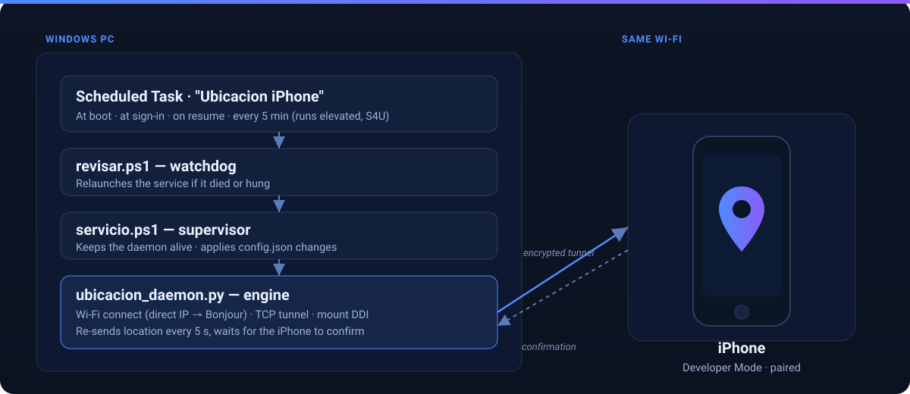

<p align="center">
  
</p>

Simulate an iPhone's GPS location (iOS 26/27) over Wi-Fi, from Windows. No jailbreak, no cable, no Mac.

I made this because the tools I found needed a Mac or a cable, and because on iOS 26/27 setting the location once doesn't work: the phone goes back to the real GPS after a few seconds. This runs in the background, re-applies the location on its own, and reconnects when the iPhone drops the Wi-Fi.

It uses Apple's developer services through [pymobiledevice3](https://github.com/doronz88/pymobiledevice3).

> Works only with your own iPhone, paired (you type a 6-digit code on the phone) and with Developer Mode on. It can't reach an iPhone you haven't paired.

## Requirements

- Windows 10/11 with [Python 3.13](https://www.python.org/downloads/) — `winget install Python.Python.3.13`
- iTunes (from apple.com) and [Bonjour](https://developer.apple.com/bonjour/) — `winget install Apple.Bonjour`
- iPhone on iOS 26 or later with Developer Mode on (Settings → Privacy & Security → Developer Mode)
- The PC and the iPhone on the same Wi-Fi, with the network set to Private in Windows

## Install

1. Clone or download the repo.
2. Run `Install or repair.bat` (asks for admin). It installs the engine to `%LOCALAPPDATA%\UbicacionIphone`, applies a Windows fix, and creates the scheduled task.
3. Run `Pair iPhone.bat` and follow it: on the iPhone, Settings → Developer → Paired Macs, tap this PC under "Other devices" and enter the 6-digit code.
4. Pick a place with `Change location.bat`.

## Usage

| File | What it does |
|---|---|
| `Status.bat` | Whether it's active, the iPhone's last confirmation, recent events |
| `Enable.bat` | Applies the location from `config.json` |
| `Disable.bat` | Back to the real location (stays off after a reboot) |
| `Change location.bat` | Pick a place from `lugares.json` or paste Google Maps coordinates |
| `Pair iPhone.bat` | Pair the iPhone over Wi-Fi (once) |
| `Install or repair.bat` | Install or repair everything; safe to re-run |

Your favorite places go in `lugares.json` (copy it from `lugares.ejemplo.json`). `config.json` is created from `config.ejemplo.json`. Both are personal and `.gitignore`d.

Set a radius greater than 0 and the daemon walks around the point at a normal pace, without going past that radius.

## How it works

<p align="center">
  
</p>

```
Scheduled task  →  revisar.ps1  →  servicio.ps1  →  ubicacion_daemon.py  →  iPhone
(at boot, at sign-in, on resume, every 5 min)
```

What the daemon handles:

- **iOS 26/27 revert on their own.** A single `simulate-location set` isn't enough, so it re-sends the location every 5 s and waits for the iPhone to answer each time.
- **The iPhone cuts the Wi-Fi when it locks.** It notices in ~6 s and reconnects straight to the last known IP (no Bonjour lookup), so the real location never gets a chance to show.
- **No new sessions while simulating:** a fresh RSD session makes the iPhone drop the simulation, so everything goes through the daemon's one connection.
- **The developer disk image** mounts itself again after the iPhone reboots.
- **Windows fix:** pymobiledevice3 crashes on the iPhone's IPv6 link-local addresses (`UnicodeError` in `getaddrinfo`); `instalar.ps1` patches `tunnel_service.py` to skip them.

The task runs as S4U (no sign-in and no stored password) with elevated privileges, which are needed to create the tunnel interface.

## Limitations

- The PC has to stay on and awake (on a laptop, set "When I close the lid: Do nothing"), and the iPhone on the same Wi-Fi.
- If the iPhone reboots, unlock it once so it reconnects.
- Find My can still show the real location: it's a system service and doesn't always use the simulated one.
- Tested with pymobiledevice3 11.43.1 (pinned in `instalar.ps1`; the fix depends on that version).

## Credits & license

Built on [pymobiledevice3](https://github.com/doronz88/pymobiledevice3) by doronz88 (GPL-3.0-or-later). The idea of re-sending the location periodically comes from [SimVirtualLocation](https://github.com/MohammedSayedAhmed/SimVirtualLocation).

Licensed under GPL-3.0 (see [LICENSE](LICENSE)).
