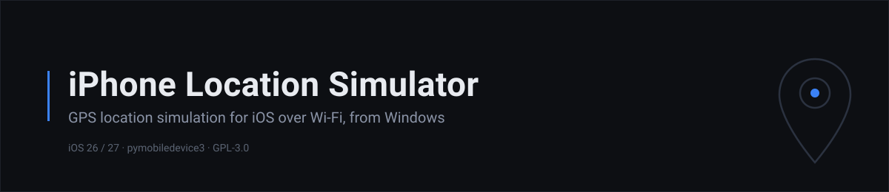

  

  
  
  
  
  

  <b>Simulate your iPhone's GPS location over Wi-Fi, from Windows.</b> 
  No jailbreak, no cable, no Mac. Built to run by itself: starts with the PC, reconnects when
  the iPhone drops the link, and re-applies the location without you touching anything.

> **Own-device tool.** This only works with **your own iPhone**, physically **paired** (you type a
> 6-digit code *on the phone*) and with **Developer Mode** enabled. It cannot be used to track or
> access someone else's device. Faking your location can break apps that rely on it and may violate
> some apps' terms of service — use it responsibly and legally.

*(Versión en español más abajo ⬇️ — [ir al español](#-español))*

---

## ✨ Why this exists

Most location-spoofing tools need a Mac, a cable, or a one-shot command that iOS 26/27 silently
undoes after a few seconds. This one is a **set-and-forget background service for Windows**: it keeps
the simulated location pinned, survives the iPhone locking its Wi-Fi, and comes back on its own after
a reboot or a dropped connection.

It uses Apple's own developer services — the same ones Xcode uses — through the excellent
[pymobiledevice3](https://github.com/doronz88/pymobiledevice3).

## 🧱 Features

- **Wi-Fi only** — no cable, no Mac, no jailbreak.
- **Stays applied** — re-sends the location every 5 s and waits for the iPhone to confirm, so iOS 26/27
  doesn't revert to the real GPS.
- **Fast reconnect** — when the iPhone drops the link it reconnects straight to the last known IP in
  ~2 s, before the phone falls back to the real location.
- **Runs itself** — a Scheduled Task starts it at boot, at sign-in, on resume, and every 5 minutes;
  a watchdog relaunches it if it ever hangs.
- **Walk mode** — set a radius and it strolls around the point at walking pace instead of standing still.
- **One-file control** — simple `.bat` shortcuts for everything (pair, activate, change place, status).

## 🗺️ How it works

  

The daemon solves the hard parts that make naïve spoofers fail on iOS 26/27:

- **iOS reverts on its own** — a single `simulate-location set` isn't enough, so the daemon re-sends
  every 5 s and waits for the phone's ack on each send.
- **The iPhone cuts Wi-Fi when it locks** — detected in ~6 s; it reconnects to the cached IP directly
  (no Bonjour lookup), bringing the location back fast enough that the real one never shows.
- **No new RSD sessions while simulating** — opening a second session makes the phone drop the
  simulation, so everything goes through the daemon's one connection.
- **Developer Disk Image** mounts automatically after the phone reboots.
- **Windows fix** — pymobiledevice3 crashes on the iPhone's IPv6 link-local addresses
  (`UnicodeError` in `getaddrinfo`); the installer patches `tunnel_service.py` to skip them.

## 🚀 Quick start

**Requirements**

- Windows 10/11 with [Python 3.13](https://www.python.org/downloads/) — `winget install Python.Python.3.13`
- iTunes (from apple.com) and [Bonjour](https://developer.apple.com/bonjour/) — `winget install Apple.Bonjour`
- iPhone on **iOS 26+** with **Developer Mode** on *(Settings → Privacy & Security → Developer Mode)*
- PC and iPhone on the **same Wi-Fi**, with the network set to **Private** in Windows

**Install**

1. Clone or download this repo.
2. Run **`Instalar o reparar.bat`** (asks for admin). Installs the engine to
   `%LOCALAPPDATA%\UbicacionIphone`, applies the Windows fix, and creates the scheduled task.
3. Run **`Emparejar iPhone.bat`** and follow it: on the iPhone, *Settings → Developer → Paired Macs*,
   tap this PC under "Other devices" and type the 6-digit code.
4. Pick a place with **`Cambiar ubicacion.bat`**.

**Everyday use**

| File | What it does |
|---|---|
| `Estado.bat` | Shows whether it's active, the iPhone's last confirmation and recent events |
| `Activar.bat` | Applies the location from `config.json` |
| `Desactivar.bat` | Back to the real location (stays off across reboots) |
| `Cambiar ubicacion.bat` | Pick a place from `lugares.json` or paste Google Maps coordinates |
| `Emparejar iPhone.bat` | Pair the iPhone over Wi-Fi (once) |
| `Instalar o reparar.bat` | Install or repair everything; safe to re-run |

Your favorite places live in `lugares.json` (copy it from `lugares.ejemplo.json`). `config.json` is
created from `config.ejemplo.json`. Both are personal and `.gitignore`d.

## 📸 Screenshots

> _Add your own here_ — e.g. `Estado.bat` running and the map on the iPhone.
> <!--  -->

## ⚠️ Limitations

- The PC must stay **on and awake** (on a laptop, set "When I close the lid: Do nothing"); the iPhone
  must be on the same Wi-Fi.
- If the iPhone reboots, unlock it once so it reconnects.
- **Find My** can still show the real location — it's a system service and doesn't always use the
  simulated one.
- Tested with pymobiledevice3 **11.43.1** (pinned in `instalar.ps1`; the Windows fix depends on it).

## 🙏 Credits & license

Built on [pymobiledevice3](https://github.com/doronz88/pymobiledevice3) by doronz88 (GPL-3.0-or-later).
The idea of re-sending the location periodically comes from
[SimVirtualLocation](https://github.com/MohammedSayedAhmed/SimVirtualLocation).

Released under the **GPL-3.0** license — see [LICENSE](LICENSE).

---

## 🇪🇸 Español

**Simulación de ubicación GPS para iPhone (iOS 26/27), por Wi-Fi y desde Windows.** Sin jailbreak,
sin cable y sin Mac. Pensada para quedar funcionando sola: arranca con la PC, reconecta cuando el
iPhone corta la conexión y vuelve a aplicar la ubicación sin que hagas nada.

> **Herramienta para tu propio dispositivo.** Solo funciona con **un iPhone tuyo**, **emparejado**
> (escribes un código de 6 dígitos *en el teléfono*) y con el **Modo de desarrollador** activado. No
> sirve para acceder al dispositivo de otra persona. Falsear la ubicación puede afectar a apps que
> dependen de ella y violar sus términos de uso: úsala de forma responsable y legal.

### Requisitos

- Windows 10/11 con [Python 3.13](https://www.python.org/downloads/) — `winget install Python.Python.3.13`
- iTunes (de apple.com) y [Bonjour](https://developer.apple.com/bonjour/) — `winget install Apple.Bonjour`
- iPhone con iOS 26+ y **Modo de desarrollador** activado *(Ajustes → Privacidad y seguridad → Modo de desarrollador)*
- PC e iPhone en la **misma red Wi-Fi**, marcada como **Privada** en Windows

### Instalación

1. Clona o descarga este repositorio.
2. Ejecuta **`Instalar o reparar.bat`** (pide administrador). Instala el motor en
   `%LOCALAPPDATA%\UbicacionIphone`, aplica un arreglo para Windows y crea la tarea programada.
3. Ejecuta **`Emparejar iPhone.bat`** y sigue las instrucciones: en el iPhone, *Ajustes → Desarrollador
   → Mac emparejados*, toca esta PC en "Otros dispositivos" y escribe el código de 6 dígitos.
4. Elige un lugar con **`Cambiar ubicacion.bat`**.

### Uso

| Archivo | Para qué |
|---|---|
| `Estado.bat` | Muestra si está activo, la última confirmación del iPhone y los últimos eventos |
| `Activar.bat` | Activa la ubicación de `config.json` |
| `Desactivar.bat` | Vuelve a la ubicación real (queda desactivado aunque se reinicie la PC) |
| `Cambiar ubicacion.bat` | Elige un lugar de `lugares.json` o pega coordenadas de Google Maps |
| `Emparejar iPhone.bat` | Empareja el iPhone por Wi-Fi (una sola vez) |
| `Instalar o reparar.bat` | Instala o repara todo; se puede ejecutar cuantas veces haga falta |

### Cómo funciona

- **iOS 26/27 vuelve solo a la ubicación real**: el daemon reenvía la ubicación cada 5 s y espera la
  confirmación del iPhone en cada envío.
- **El iPhone corta el Wi-Fi al bloquearse**: lo detecta en ~6 s y reconecta directo a la última IP
  conocida, así la ubicación real no alcanza a mostrarse.
- **No abrir sesiones nuevas mientras se simula**: todo pasa por la conexión del daemon.
- **Imagen de desarrollador**: se monta automáticamente tras un reinicio del iPhone.
- **Arreglo para Windows**: `instalar.ps1` parchea `tunnel_service.py` para saltar las direcciones
  IPv6 link-local que hacen caer a pymobiledevice3.

### Limitaciones

- La PC tiene que estar **encendida y sin suspenderse**, y el iPhone en el mismo Wi-Fi.
- Si el iPhone se reinicia, desbloquéalo una vez para que vuelva a conectar.
- **Buscar (Find My)** puede mostrar la ubicación real: es un servicio del sistema.
- Probado con pymobiledevice3 **11.43.1** (fijada en `instalar.ps1`).

### Créditos y licencia

Construido sobre [pymobiledevice3](https://github.com/doronz88/pymobiledevice3) de doronz88
(GPL-3.0-or-later). La idea de reenviar la ubicación periódicamente viene de
[SimVirtualLocation](https://github.com/MohammedSayedAhmed/SimVirtualLocation).
Distribuido bajo la licencia **GPL-3.0** (ver [LICENSE](LICENSE)).
